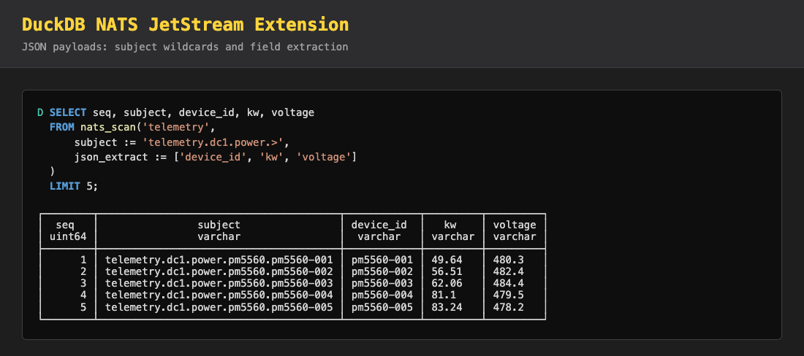
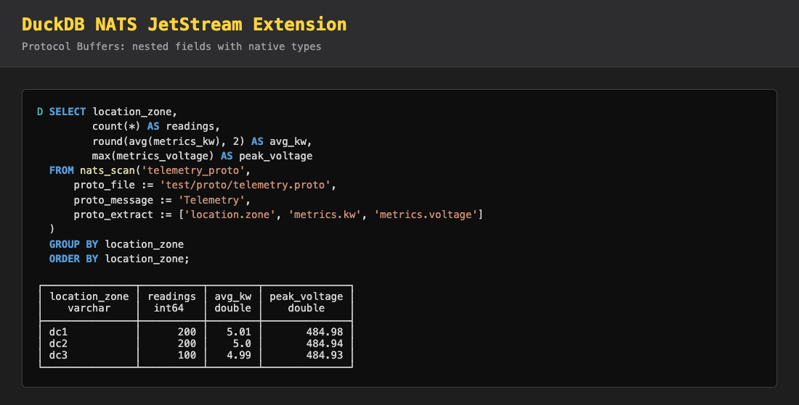

# DuckDB NATS JetStream Extension

[](https://github.com/brannn/duckdb-nats-jetstream/actions/workflows/MainDistributionPipeline.yml)
[](https://github.com/brannn/duckdb-nats-jetstream/releases/tag/v0.3.0)
[](https://github.com/duckdb/duckdb/releases/tag/v2.0.0)
[](LICENSE)
[](https://github.com/brannn/duckdb-nats-jetstream/actions)

Query NATS JetStream streams with SQL. `nats_scan` reads the messages stored in a stream as rows, narrowed by subject, sequence or time, and extracts fields from JSON and Protocol Buffers payloads.





## Quick Start

```sql
INSTALL nats_js FROM community;
LOAD nats_js;

SELECT seq, ts_nats, subject, device_id, kw
FROM nats_scan('telemetry',
    url := 'nats://nats.example.com:4222',
    subject := 'telemetry.dc1.power.>',
    start_time := TIMESTAMP '2026-10-21 09:00:00',
    end_time := TIMESTAMP '2026-10-21 09:05:00',
    json_extract := ['device_id', 'kw']
)
ORDER BY seq;
```

Times are UTC, both in `ts_nats` and in the `start_time` and `end_time` options.

## Features

- Subject filters with NATS wildcards (`*` and `>`), applied by the server
- Sequence and time ranges; time ranges are found by binary search
- JSON field extraction, including nested paths such as `location.zone`
- Protocol Buffers decoding from a `.proto` file at query time, with native DuckDB types; repeated and map fields come back as JSON
- Reads any stream, with or without `allow_direct`, and creates no consumers
- Linux, macOS and Windows

## Documentation

- [Examples](docs/EXAMPLES.md): recipes for common queries
- [Guide](docs/GUIDE.md): options, type mapping, how reads work, building and testing
- [Changelog](CHANGELOG.md)

## License

MIT License, see [LICENSE](LICENSE).
